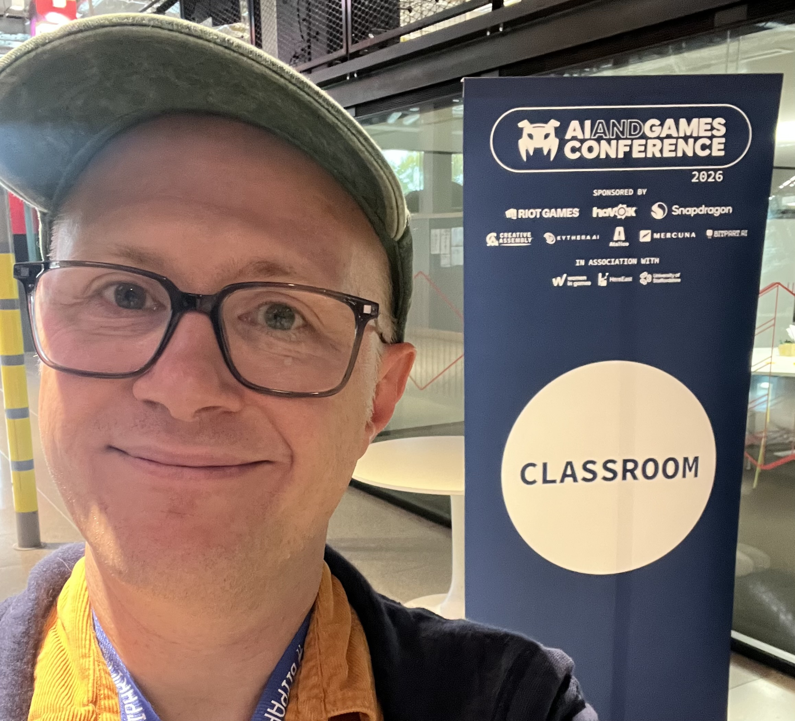

I'm back from the [AI and Games Conference](https://www.aiandgamesconference.com) - it's my first and I really love a small conference, where you can have good chats in the corridors. And you can tell the people behind this one are enthusiasts, not a big corporation. The heart and warmth on show is wonderful.

From talks with attendees, three things really stuck out to me.

## Runtime Models Augmenting, Not Replacing

Focused targeted models are hitting the runtime - At two ends of the budget scale, both Krafton with PUBG and Artificial Agency with their VR puzzle game Dimensions Double Shift are using models to allow voice control of NPC teammates to great effect. Qualcomm also has some solutions for their NPU-powered laptop CPUs.

These are not drop-in shortcuts for traditional scripted AI, instead working in tandem with existing systems. It's extra work, not replacing existing work, but it's enabling new levels of fidelity.

## Post Bubble Prepping

Between the sessions, people are talking more and more about what a post-AI-bubble world looks like. Where will frontier costs end up? Will local models be good enough to step into the gap? Is it pragmatic to start exploring options now? There’s a little bit of a preppers vibe, having a go-bag ready for when the IPOs fall short.

With that in mind, even while some are moving models to runtime, others are looking to ensure LLMs are adding value to the development pipeline without becoming a critical foundation.

## A Full Stack Is Powerful

Maxymum has a solution that uses LLMs and more traditional ML to create runtime scripted AI that can solve a specific game, in a feedback loop to pick the right approaches and iteratively improve.

The benchmark results they were able to reach with a modest amount of wall clock time was very impressive, and that scripted AI is then able to be used without token costs.

My own workshop focused on a similar problem: the importance of traditional test automation, even if in a stack with things like AI bots. I demonstrated how the [GameDriver](https://gamedriver.ai) MCP and skills can help teams without test automation expertise to generate valuable tests that can run quickly, reliably and cheaply throughout development.

And just as automation can complement human QA, it can also serve as the basis of a stack that includes QA bots or similar ML/LLM approaches.
